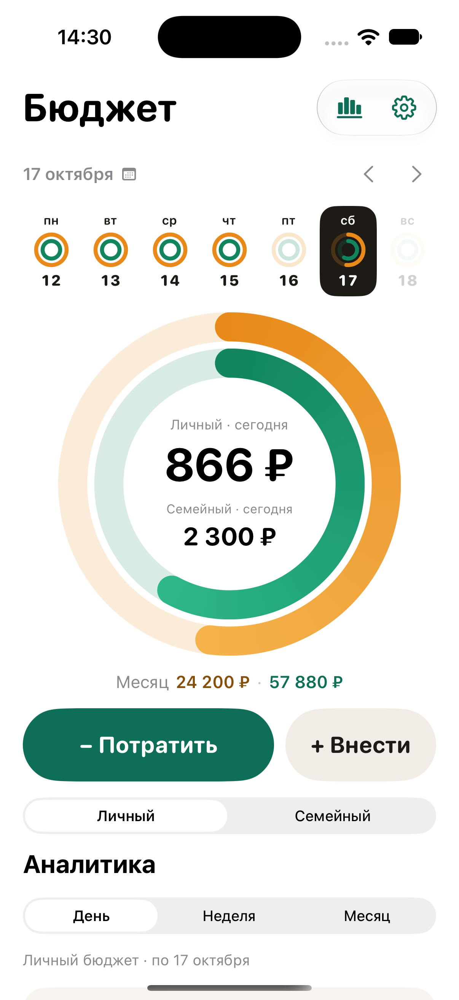

# Folki

Нативный iPhone-трекер семейного и личного бюджета. Главный вопрос: сколько можно потратить сегодня.

У семьи общий бюджет, у каждого участника — свой приватный. Участники переводят часть личных денег в семейный, а Folki показывает остаток дня и месяца для обоих бюджетов и кто сколько внёс.

Решения и этапы: [docs/ROADMAP.md](docs/ROADMAP.md).

## Состояние

Готовы главный экран, категории и короткий онбординг: семья, деньги на каждый день и первая трата — всё можно пропустить. Полный учёт с защищёнными конвертами доступен отдельно. Синхронизация через iCloud **пока не проверена на двух iPhone**: [docs/ICLOUD-GATE.md](docs/ICLOUD-GATE.md).



## Что умеет

- Личный и семейный бюджеты с распределением от текущего дня до конца месяца или выбранного числа. Дневной ориентир — свободный остаток, поделённый на оставшиеся дни.
- Регулярные платежи и копилка резервируются отдельно. Оплата из резерва уменьшает кольцо периода, дневное кольцо не меняется. Срок распределения сохраняется для следующих периодов.
- Быстрая трата в три касания: сумма на своей клавиатуре, категория, «Записать». До сохранения видно, сколько останется сегодня и как изменится сумма на следующие дни.
- Возвраты и поступления: сумма, категория, плательщик, дата и необязательное описание.
- 5 категорий по умолчанию, остальные добавляются из списка; любую категорию можно скрыть. Свои категории у каждого бюджета: цвет, значок, признак «обязательная/желание», архив. Личные категории видит только владелец.
- Взнос из личного бюджета в семейный. Это не трата: аналитика расходов и лимит не меняются. Отменить взнос может только его автор.
- История с правкой, удалением и восстановлением.
- Цели накоплений внутри каждого бюджета. Пополнение не считается тратой.
- Аналитика за день, неделю и выбранный период: траты, категории, доли «обязательные/желания», в семейном — взносы участников.
- Семья до пяти человек. В сборке iCloud — приватное приглашение через CKShare.

## Запуск

Нужны Xcode 26+ и XcodeGen (`brew install xcodegen`).

```sh
xcodegen generate
open Folki.xcodeproj
```

| Схема | Назначение |
| --- | --- |
| `Folki` | Локальный бюджет без iCloud |
| `Folki-Demo` | Отдельное приложение с примерами в памяти (для скриншотов) |
| `Folki-iCloud` | Синхронизация и приглашения, контейнер `iCloud.dev.korevagit.folki.budget` |

Полная проверка — тесты ядра и сборка всех четырёх конфигураций:

```sh
./scripts/check.sh
```

## Устройство

- `Core/Sources/FolkiDuoCore` — финансовое ядро без UI и базы: деньги в целых копейках с проверкой переполнения, расчёт дня и месяца, аналитика.
- `Core/Sources/FolkiDuoPersistence` — Core Data + `NSPersistentCloudKitContainer`. Личный бюджет хранится только в private store; общий доступ разрешён лишь для семейного корня.
- `App` — SwiftUI, iOS 26. View получают снимки через `BudgetSession` и не трогают Core Data напрямую.

Текущая модель данных — `FolkiV3`; версии `FolkiV1` и `FolkiV2` сохранены для автоматической миграции установленных бюджетов. Старые данные (каталог `FolkiBudgetV1`, контейнер `iCloud.dev.korevagit.folki`) не читаются и не переносятся.
