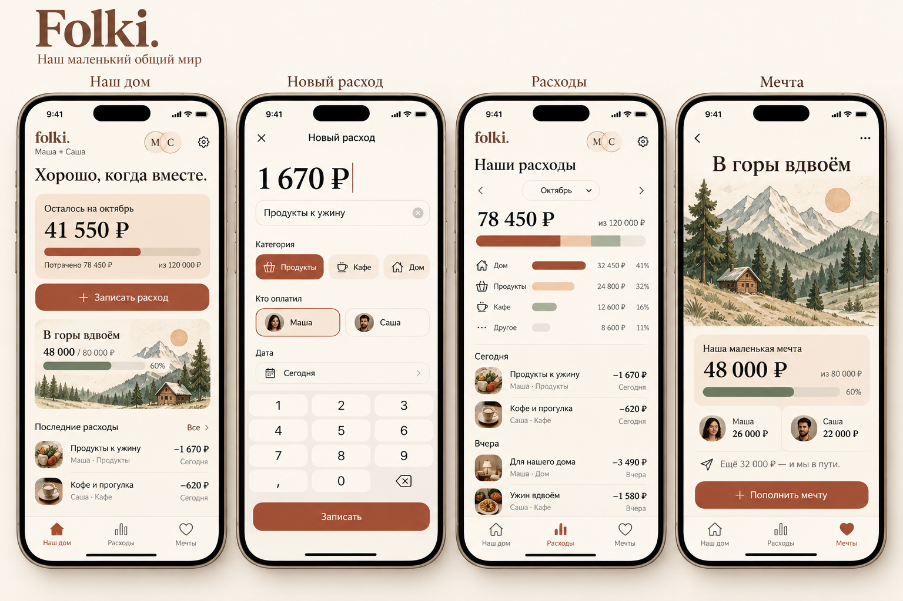

# Дизайн FolkiDuo

## Актуальное направление

[Health / Fitness для бюджета](HEALTH-NATIVE.md): системная сводка, крупные центральные кольца, история и награды. Внешнее оранжевое кольцо — остаток дня; внутреннее фиолетовое — остаток месячного свободного плана. Главная прокручивается.

- [SwiftUI-основа](../Prototype/FolkiHealthConcept.swift) — нативные компоненты Apple, демонстрационные данные.
- [Браузерное превью](interactive/folki-health-preview.html) — открыть после клонирования/скачивания; можно скроллить, нажимать карточки и добавлять расходы.
- [Редактируемый фрагмент](interactive/folki-health.fragment.html).
- [План реализации](../docs/DEVELOPMENT-PLAN.md).

Браузерное превью имитирует материал; настоящий Liquid Glass предоставляется iOS в нативном интерфейсе. Реальной синхронизации в превью нет. Ранние PNG ниже и в этой папке сохраняются как история исследования, а не актуальная спецификация. Их длины дуг и надписи иллюстративные; кодовые прототипы вычисляют геометрию из данных.

## Архив: первый визуальный вариант

Направление: «Тёплый дом». Главный экран, ввод расхода, история и структура расходов, накопления на общую мечту. Это визуальная концепция; функциональность нативного приложения пока не реализована.

Создано встроенным инструментом image_gen, 17 октября 2026.

Промпт: создать премиальный визуальный макет четырёх согласованных экранов iPhone для Folki, уютного финансового трекера пары на русском языке. Направление «Тёплый дом»: молочный фон #FBF7F0, терракотовые действия #A34B34, персиковые карточки #F1E2D5, угольный текст, приглушённый шалфей, мягкие скругления и читаемые крупные суммы. Экран «Наш дом»: бюджет 120 000 ₽, расходы 78 450 ₽, остаток 41 550 ₽, запись расхода и цель «В горы вдвоём». Экран «Новый расход»: 1 670 ₽, продукты к ужину, категории, плательщик Маша/Саша и цифровая клавиатура. Экран «Расходы»: октябрь, категории и лента операций. Экран «Мечта»: горная иллюстрация с домиком, 48 000 из 80 000 ₽, взносы Маши 26 000 ₽ и Саши 22 000 ₽, пополнение. Все четыре устройства полностью видимы рядом, единая система навигации и оформления, точный русский текст, без неона, мультяшных персонажей и водяных знаков.
